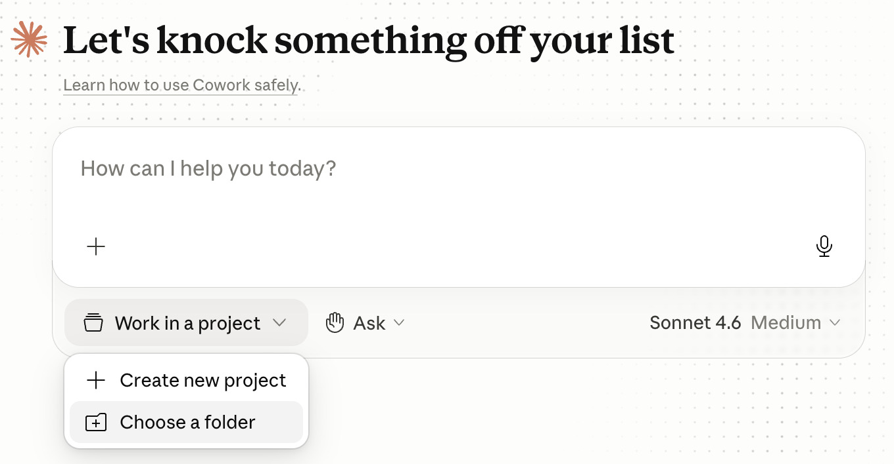
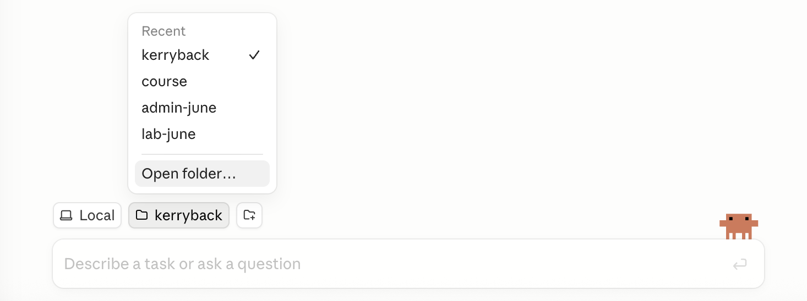
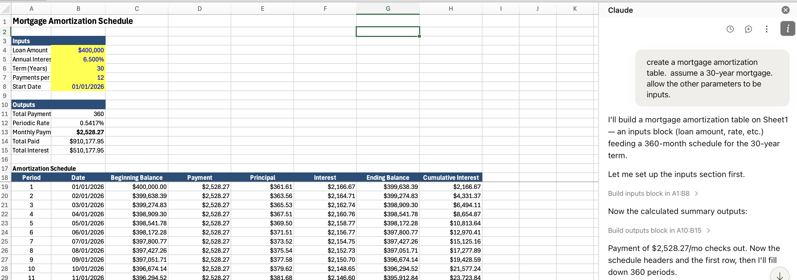

## What you will learn

::: {.cards .cards-3}
::: {.card}
[One]{.card-title}

How to work with AI to do financial analysis
:::

::: {.card .card-blue}
[Two]{.card-title}

How custom chatbots and AI agents work
:::

::: {.card .card-sand}
[Three]{.card-title}

How to work with AI to build custom chatbots and AI agents for financial analysis
:::
:::

::: {.note}
Item #1 is essential today. Item #2 is valuable today.
:::

## The purpose of #3 {.band-bottom}

- More practice on #1
- A deeper understanding of #2
- You could end up at a small firm and be the AI expert

## Course schedule {.plain-title}

```{=html}
<style>
.sched { --plum:#595460; --blue:#6f8497; width:100%; max-width:none; text-align:left; }
.sched .row { display:grid; grid-template-columns:1fr 1fr; gap:14px 20px; }
.sched .cell { display:flex; align-items:center; gap:16px; background:#EBEDEB; padding:10px 16px; }
.sched .chip { flex:0 0 120px; background:var(--plum); color:#fff; font-size:0.58em;
  font-weight:700; letter-spacing:0.12em; text-align:center; padding:9px 0; }
.sched .title { font-size:0.74em; font-weight:700; color:var(--plum); line-height:1.25; }
</style>
<div class="sched">
  <div class="row">
    <div class="cell"><span class="chip">WEEK 1</span><span class="title">Introduction</span></div>
    <div class="cell"><span class="chip">WEEK 2</span><span class="title">Agents and standing instructions</span></div>
    <div class="cell"><span class="chip">WEEK 3</span><span class="title">Customizing AI</span></div>
    <div class="cell"><span class="chip">WEEK 4</span><span class="title">AI-enabled software</span></div>
    <div class="cell"><span class="chip">WEEK 5</span><span class="title">Retrieval and fine-tuning</span></div>
    <div class="cell"><span class="chip">WEEK 6</span><span class="title">Local models and privacy</span></div>
  </div>
</div>
```

## Evaluation {.band-bottom}

Four elements, 25% each. The first three are group projects.

::: {.cards .cards-4}
::: {.card}
[One]{.card-title}

AI cost of capital exercise: calculation, visualization, report generation
:::
::: {.card .card-blue}
[Two]{.card-title}

Cost of capital app
:::
::: {.card .card-sand}
[Three]{.card-title}

Valuation Skill for Claude
:::
::: {.card .card-sage}
[Four]{.card-title}

Seated exam with AI allowed
:::
:::

::: {.note}
For each group project the deliverables are a chat, app, or agent, and a two-page Word doc explaining development and use.
:::

## HPE's experience with AI agents

::: {.highlight-box}
::: {.quote-text}
"[Alfred] removed about 90% of the manual effort that once went into preparing our weekly financial review. We used to spend hundreds of hours preparing 100+ slides for a Monday meeting."
:::
<br>
Marie Myers, CFO, Hewlett Packard Enterprise ([Fortune, Feb 2026](https://fortune.com/2026/02/12/hpe-cfo-used-ai-transform-100-slide-monday-meeting/))
:::

## Today's session

::: {.cards .cards-2}
::: {.card .card-blue}

- How large language models work
- The universe of models
- Using Claude
- Effective use of AI

:::
::: {.card .card-sand}
- Chatbots and agents
- Claude and Excel for valuation
- Corporate implementations of AI
:::
:::

## How large language models work {.divider}

## Tokenization {.plain-title}

Text is cut into pieces from a fixed vocabulary before the model sees any of it.

```
"The cat sat on the mat"  ->  ["The", " cat", " sat", " on", " the", " mat"]

"Unbelievable"            ->  ["Un", "believ", "able"]
```

Common words stay whole; rare and long words break into pieces. A typical vocabulary runs to about 100,000 tokens.

::: {.note}
Numbers break on the same rules, which have nothing to do with arithmetic. `13,963,378.65` reaches the model as a handful of unrelated pieces.
:::

## Vectors

Each token is associated with a vector, meaning a list of numbers. So, a sequence of text becomes a sequence of lists of numbers.

::: {.cards .cards-2}
::: {.card}
[Each token is a list]{.card-title}

"king" becomes a list of 4,096 numbers. "queen" becomes a different but somewhat similar list of 4,096 numbers.

Tokens used in similar contexts end up near each other.
:::

::: {.card .card-blue}
[The space is mostly empty]{.card-title}

There are far more possible vectors than there are tokens, so most points in the space name nothing.

The prediction can land between tokens. The "closest" token is usually selected but not always (so LLM output is somewhat random).
:::
:::

## The whole task {.plain-title}

::: {.lead}
Given the tokens (lists of numbers) so far, predict the token (list of numbers) that comes next. That is the entire operation.
:::

Everything a model appears to do --- answering, summarizing, writing code, refusing --- is that one prediction, repeated.

## The prediction pipeline {.band-bottom}

::: {.step-flow-6}
::: {.step-card}
::: {.step-icon}
📝
:::
::: {.step-title}
Words
:::
::: {.step-desc}
Input text
:::
:::
::: {.step-card}
::: {.step-icon}
🔤
:::
::: {.step-title}
Tokens
:::
::: {.step-desc}
Text split into units
:::
:::
::: {.step-card}
::: {.step-icon}
📐
:::
::: {.step-title}
Vectors
:::
::: {.step-desc}
4,096 numbers per token
:::
:::
::: {.step-card}
::: {.step-icon}
🧠
:::
::: {.step-title}
Neural Network
:::
::: {.step-desc}
Billions+ of parameters
:::
:::
::: {.step-card}
::: {.step-icon}
📊
:::
::: {.step-title}
Vector
:::
::: {.step-desc}
Output vector
:::
:::
::: {.step-card}
::: {.step-icon}
🎯
:::
::: {.step-title}
Token
:::
::: {.step-desc}
Predicted next token
:::
:::
:::

## A neural network is a function {.compare}

:::: {.columns}
::: {.column width="50%"}
[The idea]{.eyebrow}

$y = 4x$ is a function. The 4 is a parameter.

Change it to 3 and you have the same structure with different behavior.
:::

::: {.column width="50%"}
[The scale]{.eyebrow}

Same idea with perhaps trillions of parameters, arranged as a transformer --- the architecture published by Google researchers in 2017.
:::
::::

## From prediction to conversation {.band-bottom}

A model trained only to predict the next token continues your text. It does not answer a question.

::: {.steps}
1. Role tokens. The text is wrapped in markers: `<|user|>` your question `<|assistant|>`.
2. Instruction tuning. The model is further trained on examples where what follows `<|assistant|>` is a useful reply.
3. Reinforcement learning from human feedback. Raters score replies, and the model is trained toward what raters preferred.
:::

The mechanism did not change. What changed is which continuation is the likely one. GPT became Chat-GPT in 2022.

## The universe of models {.divider}

## A brief history {.band-bottom}

::: {.comparison-table}

| When | What |
|----|--------------|
| 2017 | Google researchers publish the transformer ("Attention Is All You Need") |
| 2020 | GPT-3 (OpenAI) shows abilities that appear with scale |
| 2022--2023 | Online chatbots. You typed, it typed back |
| 2023--2024 | Code execution and web search arrive |
| 2025 | The serious versions move to the command line, reading and writing files on your own machine. DeepSeek R1 appears |
| 2025--2026 | That command-line capability is wrapped back into an app |
| 2026 | Agents that carry out extended work on your files without you living in a terminal |

:::

## The frontier: closed weights {.plain-title}

::: {.comparison-table}

| Provider | Model | Released | Input / output, $ per M tokens |
|----|-----|----|----------|
| Anthropic | Claude Fable 5.1 | Sep 2026 | 10 / 50 |
| Anthropic | Claude Opus 5 | Jul 2026 | 5 / 25 |
| Anthropic | Claude Sonnet 5 | Jun 2026 | 2 / 10 |
| OpenAI | GPT-6 Astra | Sep 2026 | 10 / 50 |
| OpenAI | GPT-5.6 Sol | Jul 2026 | 5 / 30 (4 / 20 until Nov 21) |
| Google | Gemini 3.8 Flash | Sep 2026 | 1.50 / 7.50 (0.75 / 3.75 until Dec 31) |
| xAI | Grok 4.6 | Aug 2026 | 2 / 6 |
| Meta | Muse Spark 1.3 | Sep 2026 | 1.25 / 4.25 |

:::

::: {.footnote}
Prices are as of September 18, 2026.
:::

## The frontier: open weights {.band-bottom}

::: {.comparison-table}

| Provider | Model | Released | Input / output, $ per M tokens |
|---|---|---|---|
| Alibaba | Qwen3.8-Max | Aug 2026 | 2 / 6 |
| Zhipu (Z.ai) | GLM-5.3 | Aug 2026 | 1.40 / 4.40 |
| Moonshot | Kimi K3 | Jul 2026 | 3 / 15 |
| DeepSeek | DeepSeek V4 Pro | 2026 | 1.32 / 3.96 |
| NVIDIA | Nemotron 3 Ultra | Jun 2026 | free |
| Mistral | Mistral Medium 3.5 | Apr 2026 | 1.50 / 7.50 |

:::

::: {.note}
Open weights means anyone can download the model and run it on their own hardware. The prices are for the developer's hosting; DeepSeek charges half off-peak.
:::

## An aggregation across multiple benchmarks {.plain-title}

Artificial Analysis Intelligence Index, v4.3, best setting for each model.

::: {.comparison-table}

| Model | Score | | Model | Score |
|---|---|---|---|---|
| Claude Fable 5.1 | 53 | | GLM-5.3 (open) | 45 |
| GPT-6 Astra | 53 | | Qwen3.8-Max | 45 |
| Claude Opus 5 | 51 | | Kimi K3 (open) | 44 |
| Muse Spark 1.3 | 48 | | Grok 4.6 | 44 |
| GPT-5.6 Sol | 47 | | Gemini 3.8 Flash | 41 |

:::

::: {.note}
The best open model trails the best closed ones by 8 points.
:::

## Cost per task {.band-bottom}

Cost per task is the price per token times the number of tokens the model uses.

::: {.comparison-table}

| Model, effort setting | Index score | Cost per task |
|--------|----|----|
| GPT-6 Astra, max | 53 | $3.26 |
| Claude Fable 5.1, max | 53 | $7.63 |
| Claude Opus 5, max | 51 | $5.86 |
| GPT-5.6 Sol, max | 47 | $1.99 |
| GPT-6 Astra, low | 46 | $0.82 |

:::

::: {.note}
Astra and Fable 5.1 have the same list price, $10 / $50. At max effort Astra writes about 27,000 output tokens per task and Fable 5.1 about 78,000. Artificial Analysis, September 2026.
:::

## Enterprise adoption {.plain-title}

::: {.comparison-table}

| | Anthropic | OpenAI | Google | Open Source |
|---|---|---|---|---|
| **Enterprise LLM spend** (Menlo, Dec 2025) | [**40%**]{.amber} | 27% | 21% | 12% |
| **Company usage** (Datadog, Apr 2026) | ~46% (+23 pts YoY) | [**63%**]{.accent} of companies | ~37% (+20 pts YoY) | 13% of workloads |
| **Businesses paying** (Ramp, Aug 2026) | [**43.8%**]{.amber} | 39.8% | ? | 3.6% |
| **Code generation** (Menlo, Dec 2025) | [**54%**]{.amber} | 21% | ? | ? |

:::

::: {.footnote}
Anthropic is #1 by enterprise spend; OpenAI is #1 by breadth of adoption. The default enterprise strategy is [multi-model]{.accent} --- 69% of companies use 3+ models, routing different tasks to different providers. Closed-source models power 85--90% of enterprise workloads. The Ramp row is the share of 70,000+ US businesses paying each provider, and many pay more than one.
:::

## Why Claude for this course {.band-bottom}

::: {.cards .cards-3}
::: {.card .card-blue}
[Coding]{.card-title}

Claude Opus and Sonnet are the best coding LLMs, and most of what we do in weeks 2 through 6 is code.
:::
::: {.card .card-sand}
[Excel]{.card-title}

Anthropic released Excel integration, so Claude can generate fully functioning, nicely formatted workbooks.
:::
::: {.card .card-sage}
[Agents]{.card-title}

Anthropic created the Model Context Protocol and Claude Skills, which simplify building agents.
:::
:::

::: {.note}
OpenAI also uses MCP and has a coding agent along the same lines as Claude Code.
:::

## Using Claude {.divider}

## Project folder

In **Cowork** and **Code** modes, open a folder to give Claude access to your local files.

::: {.two-col}
::: {}
**Cowork** — click *Work in a project* at the bottom of the chat window, then *Choose a folder*

{width=85%}
:::
::: {}
**Code** — click the folder icon in the toolbar or use the folder dropdown to select *Open folder...*

{width=85%}
:::
:::

::: {.footnote}
For **Code**, selecting a folder tells Claude where to look first --- it can still work outside the folder. For **Cowork**, the folder determines where the virtual machine is mounted --- nothing outside it is visible or can be touched.
:::

## What Claude can reach

::: {.cards .cards-3}
::: {.card .card-blue}
[Claude Code]{.card-title}

The command line, and Claude Desktop → Code → Local

Can reach anywhere on your hard drive, but looks first in the project folder
:::

::: {.card .card-sand}
[Claude Cowork]{.card-title}

Can reach only the project folder
:::

::: {.card .card-sage}
[Claude Chat]{.card-title}

`claude.ai`

You must upload files
:::
:::

::: {.note}
We install Claude Code in week 2. This week is Claude Desktop and the Excel add-in.
:::

## Permissions {.shrink}

::: {.cards .cards-3}
::: {.card .card-blue}
[Cowork]{.card-title}

Selector in the chat box:

- [Manually approve]{.accent} --- Allow or Deny each action
- [Automatically approve]{.accent} --- Claude safety-checks each action and blocks unsafe ones
- [Skip all approvals]{.accent} --- nothing is checked

Computer use always requires approval
:::

::: {.card .card-sand}
[Code --- Local]{.card-title}

Selector by send button

- [Manual]{.accent} --- asks before every edit and command
- [Accept edits]{.accent} --- edits go through, commands still ask
- [Plan]{.accent} --- reads and proposes, changes nothing
- [Auto]{.accent} --- a classifier approves, blocking risky actions
- [Bypass permissions]{.accent} --- no prompts, no checks
:::
::: {.card .card-sage}
[Code --- Cloud]{.card-title}

Selector by send button

- [Accept edits]{.accent} --- edits go through, commands still ask
- [Plan]{.accent} --- reads and proposes, changes nothing
- [Auto]{.accent} --- a classifier approves, blocking risky actions
:::
:::

## Effective use of AI {.divider}

## Managing conversations {.band-bottom}

::: {.cards .cards-2}
::: {.card}
[Start a new conversation for a new task]{.card-title}

AI reads the entire conversation (the context window) each time you prompt. Irrelevant stuff consumes tokens and may be confusing.
:::

::: {.card .card-blue}
[When a conversation gets long]{.card-title}

Tell AI to write a handoff document so you can start a fresh conversation. How long? There is a tradeoff; it depends on how much is irrelevant.
:::
:::

## Good enough prompting

::: {.lead}
Most 'prompt engineering' techniques from a few years ago are now either useless or actually counterproductive. Don't tell it "you are an expert data scientist" or "think step by step."
:::

::: {.cards .cards-3}
::: {.card}
[Tell it what you want, not what to do]{.card-title}

I want ... How can we do it?
:::

::: {.card .card-blue}
[Ask AI for help in prompting]{.card-title}

If you are unsure how to ask something, ask AI how to ask it.
:::

::: {.card .card-sand}
[If something doesn't work]{.card-title}

Try again.
:::
:::

::: {.note}
Treat AI as an infinitely patient colleague with a poor memory.
:::

## Plan, evaluate, critique {.band-bottom}

::: {.cards .cards-3}
::: {.card}
[Your go-to prompt]{.card-title}

Think about the best way to do this, and let's develop a plan together.
:::

::: {.card .card-blue}
[Ex-post diagnosis]{.card-title}

Prompt: Explain what you did step by step. Did you make any decisions that we have not discussed? Write this as an HTML doc.
:::

::: {.card}
[Use AI to evaluate]{.card-title}

Start a new conversation or ask for a subagent. Ask it to evaluate the first agent's work, summarized in the HTML doc, relative to your goals.
:::

:::

## What this buys

1. AI is a prediction machine. Ask it to do something, and it will probably do what it has seen most often in its training data.

2. Ask it the best way to do something, and it will regurgitate evaluations of methods it has seen.

3. Ask it to proceed after explaining the best way, it will read the "the best way is ..." in the conversation history and follow that.

## {.no-title}

4. Misunderstandings and unstated assumptions are the most common sources of errors. Discuss before and after to surface those.

5. AI is not good at critiquing itself in the same conversation, because it reads its reasoning in the conversation history and predicts the same thing. You need a fresh context window to get a reliable critique.

## Numbers need code {.plain-title}

If a number appears and no code produced it, it was predicted. Do this instead.

::: {.prompt-box}
::: {.box-title}
Prompt
:::
Compute this in Python. Do not report a number you did not compute with code.
:::

Asked to sum three numbers 83, 16, 104, AI is much better at predicting the code `sum([83, 16, 104])` than it is at predicting what should follow `83 + 16 + 104 = `

## Hallucinations {.band-bottom}

::: {.lead}
AI predicts text. It does not check what it produces against a source.
:::

Hallucinations are most likely when it is asked to recall something specific that is not in front of it:

- Citations, quotes, and URLs
- Numbers about a particular company, year, or dataset
- Options and arguments of niche or recent software

::: {.card}
[Verify the facts]{.card-title}

Ask for a source and look it up.
:::

## Hallucinations in code

::: {.cards .cards-2}
::: {.card .card-blue}
[Caught by running it]{.card-title}

A made-up function or argument raises an error as soon as the code runs. The agent reads the traceback and fixes it.
:::

::: {.card}
[Not caught by running it]{.card-title}

The wrong column, a join that drops rows, a filter on the wrong year. The code runs and returns a number.
:::
:::

::: {.note}
The second kind is a misunderstanding or an unstated assumption, not a hallucination. Discussing the plan beforehand and the decisions afterwards is what surfaces it.
:::

## Chatbots and agents {.divider}

## Chatbots and agents

::: {.cards .cards-2}
::: {.card .card-blue}
[Chatbots]{.card-title}

- System prompt with base instructions
- Maintain conversation history
- LLMs are stateless --- no memory of prior prompts & responses
:::

::: {.card .card-sand}
[AI Agents]{.card-title}

- Chatbots with tools
- The LLM writes instructions to use tools
- Examples: retrieve data, execute code, generate charts, Excel workbooks, Word docs, PowerPoint decks, images, videos
:::
:::

## Anatomy of a chatbot {.plain-title}

```{=html}
<svg viewBox="0 0 1040 480" role="img" aria-label="The chatbot loop: six steps from the user to the LLM and back, with the messages array growing each turn."
     style="display:block;margin:0 auto;width:990px;max-width:100%"
     font-family="Meiryo,'Zen Kaku Gothic New','Segoe UI',system-ui,sans-serif">
  <defs>
    <marker id="cb-out" viewBox="0 0 10 8" refX="9" refY="4" markerWidth="9" markerHeight="7" orient="auto">
      <path d="M0 0 L10 4 L0 8 Z" fill="#6f8497"/>
    </marker>
    <marker id="cb-back" viewBox="0 0 10 8" refX="9" refY="4" markerWidth="9" markerHeight="7" orient="auto">
      <path d="M0 0 L10 4 L0 8 Z" fill="#595460"/>
    </marker>
  </defs>

  <!-- the request leg and the response leg, drawn as one rectilinear circuit -->
  <path d="M145 210 V100 H895 V200" fill="none" stroke="#6f8497" stroke-width="3" marker-end="url(#cb-out)"/>
  <path d="M895 300 V400 H145 V310" fill="none" stroke="#595460" stroke-width="3" marker-end="url(#cb-back)"/>

  <!-- the two ends -->
  <rect x="60" y="210" width="170" height="90" fill="#595460"/>
  <text x="145" y="263" text-anchor="middle" font-size="26" font-weight="700" letter-spacing="2" fill="#fbfbfa">User</text>
  <rect x="810" y="210" width="170" height="90" fill="#595460"/>
  <text x="895" y="263" text-anchor="middle" font-size="26" font-weight="700" letter-spacing="2" fill="#fbfbfa">LLM</text>

  <!-- what travels round the loop -->
  <rect x="340" y="195" width="360" height="120" fill="#EBEDEB"/>
  <rect x="340" y="195" width="4" height="120" fill="#595460"/>
  <text x="520" y="235" text-anchor="middle" font-size="22" font-weight="700" letter-spacing="1" fill="#595460" font-family="'JetBrains Mono','Fira Code',Consolas,monospace">messages[]</text>
  <text x="520" y="265" text-anchor="middle" font-size="15" fill="#3b3842">system + user₁ + assistant₁ + user₂ + …</text>
  <text x="520" y="291" text-anchor="middle" font-size="15" font-style="italic" fill="#6f6b77">grows each turn</text>

  <g font-size="17" font-weight="700" fill="#3b3842" text-anchor="middle">
    <text x="235" y="62">User types prompt</text>
    <text x="520" y="62">Append to messages[]</text>
    <text x="800" y="50">Send system prompt</text>
    <text x="800" y="436">LLM returns response</text>
    <text x="520" y="436">Append response</text>
    <text x="235" y="436">Display to user</text>
  </g>
  <text x="800" y="70" text-anchor="middle" font-size="15" fill="#6f6b77">+ full history to LLM</text>

  <g text-anchor="middle" font-size="18" font-weight="700" fill="#fbfbfa">
    <circle cx="235" cy="100" r="17" fill="#6f8497"/><text x="235" y="107">1</text>
    <circle cx="520" cy="100" r="17" fill="#6f8497"/><text x="520" y="107">2</text>
    <circle cx="800" cy="100" r="17" fill="#6f8497"/><text x="800" y="107">3</text>
    <circle cx="800" cy="400" r="17" fill="#595460"/><text x="800" y="407">4</text>
    <circle cx="520" cy="400" r="17" fill="#595460"/><text x="520" y="407">5</text>
    <circle cx="235" cy="400" r="17" fill="#595460"/><text x="235" y="407">6</text>
  </g>
</svg>
```

## Anthropic's system prompts

Anthropic publishes the system prompts for its models: <https://docs.claude.com/en/release-notes/system-prompts>

## Anatomy of an agent

```{=html}
<svg viewBox="0 0 1040 580" role="img" aria-label="The agent loop: the same circuit as a chatbot, with a tool call branching down to the tools the harness executes."
     style="display:block;margin:0 auto;width:880px;max-width:100%"
     font-family="Meiryo,'Zen Kaku Gothic New','Segoe UI',system-ui,sans-serif">
  <defs>
    <marker id="ag-out" viewBox="0 0 10 8" refX="9" refY="4" markerWidth="9" markerHeight="7" orient="auto">
      <path d="M0 0 L10 4 L0 8 Z" fill="#6f8497"/>
    </marker>
    <marker id="ag-back" viewBox="0 0 10 8" refX="9" refY="4" markerWidth="9" markerHeight="7" orient="auto">
      <path d="M0 0 L10 4 L0 8 Z" fill="#595460"/>
    </marker>
    <marker id="ag-tool" viewBox="0 0 10 8" refX="9" refY="4" markerWidth="9" markerHeight="7" orient="auto">
      <path d="M0 0 L10 4 L0 8 Z" fill="#7d8f68"/>
    </marker>
  </defs>

  <path d="M145 210 V100 H895 V200" fill="none" stroke="#6f8497" stroke-width="3" marker-end="url(#ag-out)"/>
  <path d="M895 300 V400 H145 V310" fill="none" stroke="#595460" stroke-width="3" marker-end="url(#ag-back)"/>

  <rect x="60" y="210" width="170" height="90" fill="#595460"/>
  <text x="145" y="263" text-anchor="middle" font-size="26" font-weight="700" letter-spacing="2" fill="#fbfbfa">User</text>
  <rect x="810" y="210" width="170" height="90" fill="#595460"/>
  <text x="895" y="263" text-anchor="middle" font-size="26" font-weight="700" letter-spacing="2" fill="#fbfbfa">LLM</text>

  <rect x="320" y="195" width="400" height="120" fill="#EBEDEB"/>
  <rect x="320" y="195" width="4" height="120" fill="#595460"/>
  <text x="520" y="235" text-anchor="middle" font-size="22" font-weight="700" letter-spacing="1" fill="#595460" font-family="'JetBrains Mono','Fira Code',Consolas,monospace">messages[]</text>
  <text x="520" y="265" text-anchor="middle" font-size="14" fill="#3b3842">system + tools + user + assistant + tool_result + …</text>
  <text x="520" y="291" text-anchor="middle" font-size="14" font-style="italic" fill="#6f6b77">grows each turn; includes tool calls and results</text>

  <g font-size="17" font-weight="700" fill="#3b3842" text-anchor="middle">
    <text x="235" y="62">User types prompt</text>
    <text x="560" y="50">Send system prompt</text>
    <text x="800" y="436">LLM returns</text>
    <text x="520" y="436">If tool call → execute tool</text>
    <text x="235" y="436">If final answer → display to user</text>
  </g>
  <g font-size="15" fill="#6f6b77" text-anchor="middle">
    <text x="560" y="70">+ tool definitions + history</text>
    <text x="800" y="456">text OR tool call</text>
    <text x="520" y="456">send result back, loop to step 2</text>
  </g>

  <g text-anchor="middle" font-size="18" font-weight="700" fill="#fbfbfa">
    <circle cx="235" cy="100" r="17" fill="#6f8497"/><text x="235" y="107">1</text>
    <circle cx="560" cy="100" r="17" fill="#6f8497"/><text x="560" y="107">2</text>
    <circle cx="800" cy="400" r="17" fill="#595460"/><text x="800" y="407">3</text>
    <circle cx="520" cy="400" r="17" fill="#595460"/><text x="520" y="407">4</text>
    <circle cx="235" cy="400" r="17" fill="#595460"/><text x="235" y="407">5</text>
  </g>

  <!-- the branch out of the loop: the harness, not the model, runs these -->
  <path d="M960 300 V470" fill="none" stroke="#7d8f68" stroke-width="3" stroke-dasharray="9 7" marker-end="url(#ag-tool)"/>
  <text x="948" y="385" text-anchor="middle" font-size="15" font-weight="700" fill="#7d8f68" transform="rotate(-90 948 385)">tool call</text>

  <rect x="60" y="480" width="920" height="90" fill="#595460"/>
  <text x="520" y="508" text-anchor="middle" font-size="16" font-weight="700" letter-spacing="1" fill="#A5B592">Tools (defined as JSON, executed by the harness)</text>
  <g font-size="16" font-weight="700" fill="#595460" text-anchor="middle" font-family="'JetBrains Mono','Fira Code',Consolas,monospace">
    <rect x="100" y="522" width="190" height="34" fill="#EBEDEB"/><text x="195" y="545">run_sql</text>
    <rect x="310" y="522" width="190" height="34" fill="#EBEDEB"/><text x="405" y="545">list_tables</text>
    <rect x="520" y="522" width="200" height="34" fill="#EBEDEB"/><text x="620" y="545">describe_table</text>
    <rect x="740" y="522" width="200" height="34" fill="#EBEDEB"/><text x="840" y="545">run_python</text>
  </g>
</svg>
```

## The tools of Claude Code {.plain-title}

::: {.comparison-table}

| Tool | What it does |
|---|---|
| Read, Write, Edit | Open and change files --- documents, spreadsheets, code |
| Bash | Run commands and programs on the machine |
| Glob, Grep | Find files, and search inside them |
| WebSearch, WebFetch | Run a search, then download and read a page |
| Task | Start a subagent with its own instructions |
| MCP connectors | Call an outside service: a database, an API |

:::

## Claude and Excel {.divider}

## How Claude builds a workbook

::: {.cards .cards-2}
::: {.card}
[Creating a workbook]{.card-title}

Claude writes Python --- the openpyxl library --- that loops over every cell and inserts data, formulas, and formatting.
:::

::: {.card .card-blue}
[Editing a workbook]{.card-title}

To edit a workbook, Claude reads the XML and edits it. An `.xlsx` unzips into one XML file per worksheet, with the text in `sharedStrings.xml` and the formatting in `styles.xml`; each cell is an element holding a value or a formula. Claude rewrites those elements and repacks the file, so charts, pivot tables, and formatting it did not touch are unchanged.
:::
:::

::: {.note}
The formulas are live. A workbook Claude builds opens in Excel as a model you can change.
:::

## The Claude plugin for Excel {.band-bottom}

A chat panel inside Excel itself --- no folder, no Python, no terminal. It works on the sheet that is already open.

::: {.card .card-blue}
[Installing]{.card-title}

- In Excel, add it from `Home → Add-ins`
- If your organization blocks the Office Store, IT deploys it instead through the Microsoft 365 Admin Center
- Sign in to your Claude account when prompted
:::

## Example {.plain-title}

{width=85% fig-align="center"}

## Demo: a valuation workbook {.band-bottom}

::: {.prompt-box}
::: {.box-title}
Prompt
:::
Build an Excel workbook that values a company by discounted cash flow. Put the assumptions on their own sheet, drive every cash flow off them with live formulas, and add a sensitivity table over the discount rate and the terminal growth rate.
:::

::: {.note}
Change an assumption afterwards. If the valuation does not move, the number was typed in rather than computed.
:::

## Case: Valuing Walmart 2010

[Harvard Business Publishing, W11058](https://hbsp.harvard.edu/product/W11058-PDF-ENG)

::: {.steps}
1. Work the valuation with Claude and Excel rather than by hand.
2. Ask it to explain every assumption it made that you did not give it.
3. Start a fresh conversation and ask a second Claude to critique the first one's valuation.
:::

::: {.note}
Step 3 is the plan-evaluate-critique pattern from earlier in the session.
:::

## Corporate implementations of AI {.divider}

## Case: Implementing AI at Deloitte

[Harvard Business Publishing, HEC382](https://hbsp.harvard.edu/product/HEC382-PDF-ENG)

[Other reading]{.eyebrow}

- [CNBC on JPMorgan Chase's LLM Suite](https://www.cnbc.com/2025/09/30/jpmorgan-chase-fully-ai-connected-megabank.html)
- [State of AI in Business 2025](https://mlq.ai/media/quarterly_decks/v0.1_State_of_AI_in_Business_2025_Report.pdf)
- [Generative AI Reshaping Teamwork and Expertise](https://papers.ssrn.com/sol3/papers.cfm?abstract_id=5188231)

## Discussion {.band-bottom}

::: {.highlight-box}

1. What is your experience with AI?
2. What do you hope to do with AI?
3. Where is your company at in implementing AI?

:::

When we come back: what was common among your group members on each topic, and how did you differ?

## Upcoming {.band-bottom}

::: {.cards .cards-2}
::: {.card .card-dark}
[Week 2: Agents and standing instructions]{.card-title}

- Agent tools and harnesses
- Sandboxed agents
- System prompts
- CLAUDE.md, SKILL.md
- Plugins and marketplaces
:::

::: {.card .card-light}
[The course ahead]{.card-title}

- Week 3: Customizing AI
- Week 4: AI-enabled software
- Week 5: Retrieval and fine-tuning
- Week 6: Local models and privacy
:::
:::
