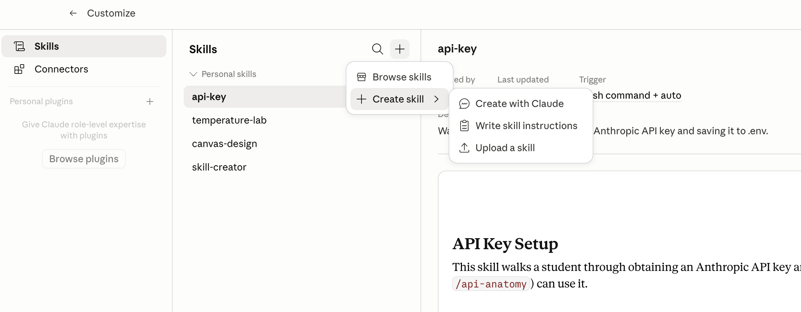

## Today's session

- Instructions that are always read (CLAUDE.md, AGENTS.md)
- Instructions that are read when needed (SKILL.md)
- Customizing

## CLAUDE.md

::: {.cards .cards-2}
::: {.card .card-blue}

- At the start of each conversation, Claude looks in specific places for CLAUDE.md files
- It looks in your home directory (C:\\users\\yourname on Windows) and it looks in the project folder
:::
::: {.card .card-sand}

- A CLAUDE.md is a text file that contains instructions for Claude
- Claude reads the entire file, so use it sparingly
:::
:::

::: {.footnote}
You could get the same behavior by pasting the instructions in the prompt window. OpenAI calls the file AGENTS.md; Google reads either AGENTS.md or GEMINI.md.
:::

## The equivalent in each tool {.plain-title}

::: {.comparison-table}

| Tool | Where standing instructions live |
|---|---|
| [Chat and Cowork]{.accent} | Settings → General → Instructions for Claude, plus instructions on each project |
| [Code --- Local]{.accent} | CLAUDE.md files on your hard drive |
| [Code CLI]{.accent} | the same CLAUDE.md files |

:::

::: {.footnote}
Cowork keeps its instructions in the app, not in files --- global in Settings, per-project in the project panel, per-folder in a text box on the folder you select. Chat reads only what you upload or add to a project, so its standing instructions live in the settings rather than in a file.
:::

## Example: Keep things organized

- Handoff (summary) docs, AI outputs, and scripts proliferate over time
- To reduce the amount of reading (and tokens) AI must do to locate things, have Claude keep a map of what each file is and what it draws on

::: {.code-box}
::: {.box-title}
In CLAUDE.md --- one line
:::
```
Read MAP.md at the start of every session to get oriented in this folder.
```
:::

::: {.note}
Building and rebuilding the map is a skill, not a CLAUDE.md rule. We will get to that.
:::

## Chat and Cowork {.band-bottom}

::: {.cards .cards-3}
::: {.card .card-blue}
[Account-wide]{.card-title}

Settings → Instructions for Claude. Read at the start of every conversation and every scheduled task.
:::
::: {.card .card-sand}
[One project]{.card-title}

A project carries its own instructions alongside its folders and links. Cowork projects live on your computer; Chat projects live in your Claude account.
:::
::: {.card .card-sage}
[Project memory]{.card-title}

A Cowork project also keeps a memory store. Claude writes to it during a session and reads it back the next time.
:::
:::

## Where Code looks for CLAUDE.md {.plain-title}

Loaded in this order --- broadest first, most specific last:

::: {.steps}

1. A managed file installed by IT, applying to everyone on the machine
2. `~/.claude/CLAUDE.md` --- applies to you in every project
3. `CLAUDE.md` or `.claude/CLAUDE.md` in the project folder --- checked into git and shared with the team
4. `CLAUDE.local.md` in the project folder --- yours alone, kept out of git

:::

::: {.note}
`/init` drafts one from your folder, `#` at the start of a prompt appends a line, and `/memory` opens the files for editing. A folder with an `AGENTS.md` and no `CLAUDE.md` is read the same way.
:::

## Skills

::: {.cards .cards-2}
::: {.card .card-blue}

At the start of each conversation, Claude also looks in specific places for SKILL.md files
:::
::: {.card .card-sand}

It looks in your home directory (C:\\users\\yourname on Windows) and it looks in the project folder
:::
:::

::: {.cards .cards-1}
::: {.card .card-dark}

Skills are text files saved on your hard drive. Claude reads the top of each SKILL.md file (the skill description) on startup, and it reads the bulk of the file [only when needed]{.accent}
:::
:::

## Anthropic skills {.band-bottom}

Anthropic publishes its own skills at [https://github.com/anthropics/skills](https://github.com/anthropics/skills)

[Pre-installed on claude.ai and Claude Desktop]{.eyebrow}

::: {.cards .cards-4}
::: {.card .card-blue}
[xlsx]{.card-title}

Excel workbooks
:::
::: {.card .card-sand}
[docx]{.card-title}

Word documents
:::
::: {.card .card-sage}
[pptx]{.card-title}

PowerPoint decks
:::
::: {.card}
[pdf]{.card-title}

PDF files
:::
:::

::: {.footnote}
These four activate on their own when a task calls for one. Code execution and file creation must be turned on under Settings → Capabilities.
:::

## Invoking skills

::: {.cards .cards-3}
::: {.card .card-blue}
[Slash Command]{.card-title}

- Type `/skillname` at the prompt
- Example: `/plan`
- Invokes the skill directly
:::
::: {.card .card-sand}
[Natural Language]{.card-title}

- Describe what you need in plain English
- Example: "Use your planning mode and evaluate ..."
:::
::: {.card}
[Automatic]{.card-title}

- Claude may invoke a skill on its own
- Example: "Create an Excel file" triggers the xlsx skill automatically
- Driven by the skill's description
:::
:::

## Adding a skill in Claude Desktop {.plain-title}

Skills are saved prompts for specific tasks --- reusable workflows you can share with your team.

::: {.two-col}
::: {}
1. Click **Customize** in the left sidebar
2. Select **Skills**
3. Click **+** → **Create skill** → **Upload a skill**
4. Drag and drop or browse to a `SKILL.md` file

Works the same in Chat, Cowork, and Code modes. In Cowork and Code, you can tell Claude to create and save the skill.
:::
{width=100%}
:::

## Creating skills

::: {.step-flow-3}
::: {.step-card}
::: {.step-desc}
Usual process is you work on something, iterating until you get what you want.
:::
:::

::: {.step-card}
::: {.step-desc}
You realize you may want the same thing again, and you don't want to go through the iteration again.
:::
:::

::: {.step-card}
::: {.step-desc}
Solution: tell Claude to package the final version as a skill.
:::
:::
:::

## Example 1 {.band-bottom}

::: {.cards .cards-2}
::: {.card .card-blue}

Tell Claude to create a skill for your folder named "pirate" with this content: "Always answer like a pirate" (On Claude Desktop: Customize/Skills/Add/Create a skill).
:::
::: {.card .card-sand}

Start a new conversation. Enter [/pirate What is the meaning of life?]{.accent}
:::

:::

## Example 2 {.plain-title}

::: {.steps}

1. Ask Claude to add one line to your project `CLAUDE.md`: read `MAP.md` at the start of every session
2. Tell Claude to create an `update-map` skill that scans the folder and writes `MAP.md` as a table --- file, what it is, what it draws on --- creating the file if there isn't one
3. Start a new conversation and enter [/update-map]{.accent}. Open `MAP.md` and read it
4. Add a file to the folder, run [/update-map]{.accent} again, and find the new entry

:::

::: {.footnote}
The skill writes the map on its first run, so there is nothing to set up before you invoke it. The `CLAUDE.md` line takes effect in the next conversation, not the one you are in.
:::

## Example 3 {.band-bottom}

[critique]{.accent}: skill I wrote to review work Claude has produced --- a draft, a deck, or code.

::: {.steps}

1. Launches reviewer agents in parallel: correctness traced back to the source files, clarity, and a devil's advocate that reads the code
2. Argues against every finding and keeps only the ones that survive
3. Publishes an HTML page with the findings and the options for what to do next

:::

::: {.footnote}
Invoked with [/critique]{.accent}. It runs several subagents, so it takes longer and uses more tokens than most skills.
:::

## Plugins

A shipping protocol for skills plus scripts, MCP connectors, and other files

::: {.card .card-blue}

Visit the Anthropic plugin directory: Enter [/plugin]{.accent} as a Claude prompt or visit [https://github.com/anthropics/claude-plugins-official](https://github.com/anthropics/claude-plugins-official)
:::

::: {.cards .cards-2}
::: {.card .card-sand}

Thousands of people (including your prof) have created their own plugin marketplaces. Everything is free.
:::
::: {.card .card-sage}

The most useful things will be the ones you create (with Claude's assistance)
:::
:::

## Example: Anthropic's Data plugin {.band-bottom}

::: {.card .card-blue}
[What it adds]{.card-title}

Six commands --- [/analyze]{.accent}, [/explore-data]{.accent}, [/write-query]{.accent}, [/create-viz]{.accent}, [/build-dashboard]{.accent}, [/validate-data]{.accent} --- against any SQL database with an MCP server, or an uploaded CSV
:::

[/plugin marketplace add anthropics/knowledge-work-plugins]{.shell-cmd} then [/plugin install data@knowledge-work-plugins]{.shell-cmd}

## What the plugin adds {.plain-title}

A checklist with named failure modes, each with how to detect it and how to prevent it:

::: {.comparison-table}

| Pitfall | What goes wrong |
|---|---|
| [Join explosion]{.accent} | A many-to-many join multiplies rows and inflates every count and sum |
| [Survivorship bias]{.accent} | Only the entities that still exist are in the data; the churned ones are missing |
| [Incomplete period]{.accent} | A partial month compared against a full one |
| [Denominator shifting]{.accent} | "Eligible" or "active" was redefined between the periods being compared |
| [Average of averages]{.accent} | Group averages averaged together when the groups are different sizes |
| [Timezone mismatch]{.accent} | One source on UTC, another on local time, rolled up at different cutoffs |
| [Selection bias]{.accent} | The segment is defined by the outcome being measured |

:::

::: {.footnote}
Plus Simpson's paradox, a QA checklist covering data quality, calculation, reasonableness and presentation, and a verdict of ready to share, share with caveats, or needs revision.
:::

## A class marketplace

Plugins built by a previous class of mine, plus my own.

[/plugin marketplace add kerryback/mgmt803-plugins]{.shell-cmd}

::: {.cards .cards-2}
::: {.card .card-blue}
[critique]{.card-title}

[Kerry Back]{.eyebrow}

The reviewer from Example 3
:::
::: {.card .card-sand}
[job-scout]{.card-title}

[bazingasc, MGMT 803]{.eyebrow}

Scores current job postings against your resume and says what to fix
:::
:::

[/plugin install critique@mgmt803]{.shell-cmd} and [/plugin install job-scout@mgmt803]{.shell-cmd}

::: {.footnote}
Start a new session after installing --- a plugin's skills don't load until the session restarts. Job Scout can write its digest to a file, so no Gmail connector is needed. Type [/plugin]{.accent} alone to browse the rest.
:::

## Breakout {.centered-statement}

Brainstorm as a group: What workflows can I use a Claude skill for?

## Example: 3-2-1 crack spread

::: {.step-flow-2}
::: {.step-card}
::: {.step-title}
1. Prompt
:::
::: {.step-desc}
Ask Claude to get the NY gasoline, NY heating oil, and Cushing WTI prices and compute the 3-2-1 crack spread on a per-barrel basis. Ask Claude to produce a plot.
:::
:::

::: {.step-card}
::: {.step-title}
2. Skill
:::
::: {.step-desc}
Ask Claude to produce a "crack" skill. On the prompt /crack, Claude should display a plot of the crack spread over the past 12 months
:::
:::
:::

## Takeaways {.centered-statement}

::: {.card .card-dark}
The same job can be a prompt or a skill. Prompt it once to see it work. Save it as a skill when you will run it again.
:::

## Extra work {.divider}

## Your workflows {.centered-statement}

::: {.highlight-box}
Think of a task that you need to perform regularly. Ask Claude to create hypothetical data (reports, Excel files, whatever your task involves) for you to experiment with. Perform the task using a prompt. Create a skill so that it is performed the same way each time.
:::

## Toward the Valuation Skill {.band-bottom}

The third group project is a Valuation Skill for Claude. This week is where it starts.

::: {.steps}
1. Do a valuation with Claude once, by prompting, and iterate until the output is what you want.
2. Write down what you had to say every time, and what you had to correct every time.
3. That is the content of the skill.
:::

## Upcoming {.band-bottom}

::: {.cards .cards-2}
::: {.card .card-dark}
[Week 3: Customizing AI]{.card-title}

- Creating custom skills
- Sharing as plugins
:::

::: {.card .card-light}
[The course ahead]{.card-title}

- Week 4: AI-enabled software
- Week 5: Retrieval and fine-tuning
- Week 6: Local models and privacy
:::
:::
